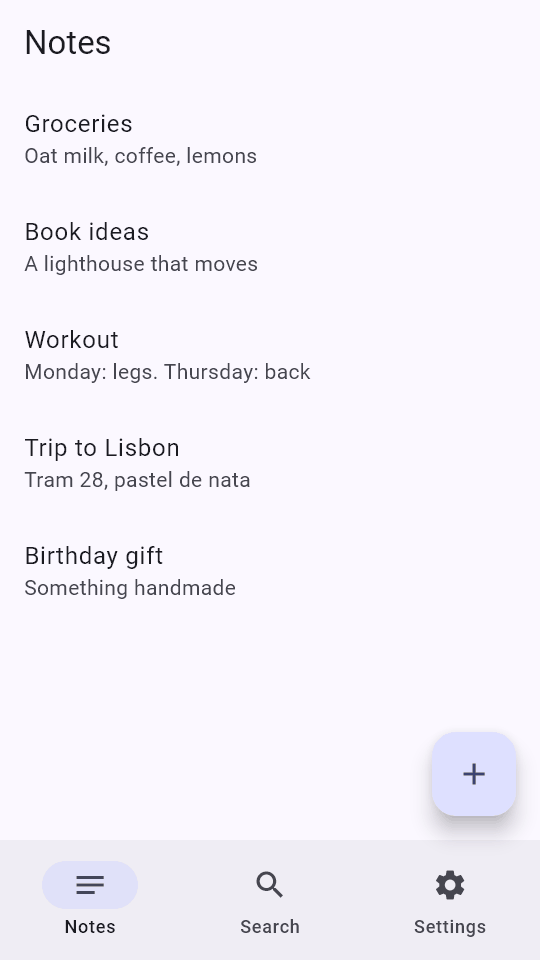
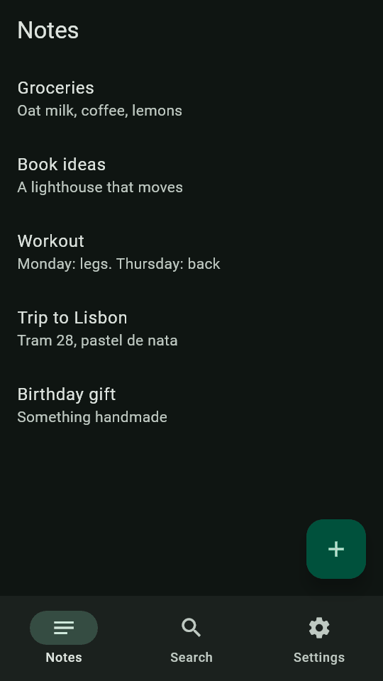

# guided_tour_overlay

[](https://pub.dev/packages/guided_tour_overlay)
[](LICENSE)

A guided tour for Flutter apps that only **shows**, never blocks.

A hopping arrow, a pulsing ring and an explanation card float above your live UI. Nothing is dimmed or locked: taps always reach the app underneath, and the user can skip at any time. You decide what happens on each step, for example switching a tab.



## Why another tour package?

Most tour packages dim the screen and cut a hole into the dark layer. That blocks the app, confuses screen readers and gets in the way when the target moves. This package does the opposite:

- **Never blocks.** No scrim, no modal barrier. The arrow, the ring and the label ignore all pointer events. Only the card takes taps.
- **Follows the target.** The target is found through a `GlobalKey` and measured every frame, so rotation, scrolling and animations just work.
- **Tab-friendly.** A target that is built but hidden (for example in an inactive tab of an `IndexedStack`) still gets its arrow. Switch to the right tab in `onStepChanged`.
- **Safe against double taps.** `next` and `back` ignore calls within 350 ms of the last step change, so a fast double tap never skips a step.
- **Never crashes your app.** Errors from your storage or your callbacks are reported through `FlutterError.reportError` and the tour keeps going.
- **No texts, no storage, no extra dependencies.** All labels come from you, progress goes wherever you want, and the package only depends on Flutter and `material_ui`.
- **Needs Flutter 3.50 or newer** and `material_ui` in your app (since 0.3.0). Apps that still use `package:flutter/material.dart` stay on 0.2.x: the Material widgets and `Theme` of the two libraries are different classes.
- **Accessible.** The card is a live region with a header, the arrow is hidden from screen readers, and with "reduce animations" the arrow and ring stand still.

## Install

```sh
flutter pub add guided_tour_overlay
```

## What you get

| Class | What it does |
|---|---|
| `TourController` | Runs the tour: current step, `start`, `next`, `back`, `skip`, callbacks, tap guard. |
| `TourStep` | One step: id, title, text, an optional target `GlobalKey` and an optional arrow label. |
| `TourOverlay` | Puts the arrow on the target and the card where you want it. |
| `TourCard` | The explanation card with progress, title, text and the "back", "next" and "skip" buttons. |
| `ArrowRing` | The hopping arrow with a pulsing ring. Use it alone if you only need the marker. |
| `ArrowRingStyle` | Colors, sizes and icons of the arrow, the ring and the label. |
| `TourStorage` | A tiny interface to keep progress. The package stores nothing itself. |

## Quick start

```dart
final plusKey = GlobalKey();
final controller = TourController(
  steps: [
    TourStep(
      id: 'plus',
      title: 'Add something',
      text: 'Tap the plus to create a new entry.',
      target: plusKey,
      arrowLabel: 'Here',
    ),
    const TourStep(id: 'done', title: 'That is it', text: 'Enjoy the app.'),
  ],
  onStepChanged: (index, step) {
    // For example: switch to the tab that belongs to this step.
  },
);

// Above your app, inside a Stack:
ListenableBuilder(
  listenable: controller,
  builder: (context, _) {
    final step = controller.current;
    if (step == null) return const SizedBox.shrink();
    return Positioned.fill(
      child: TourOverlay(
        target: step.target,
        arrowLabel: step.arrowLabel,
        cardAlignment: Alignment.topCenter,
        card: TourCard(
          title: step.title,
          text: step.text,
          progress: '${controller.index! + 1} of ${controller.steps.length}',
          backLabel: 'Back',
          nextLabel: 'Next',
          skipLabel: 'Skip',
          onBack: controller.index == 0 ? null : controller.back,
          onNext: controller.next,
          onSkip: controller.skip,
        ),
      ),
    );
  },
);

controller.start();
```

Call `controller.dispose()` when you are done with it. A complete, runnable app is in [`example/`](example).

## Make it yours

Everything about the arrow is configurable through `ArrowRingStyle`:



```dart
TourOverlay(
  // ...
  arrowStyle: const ArrowRingStyle(
    color: Color(0xFF2DD4A7),
    labelColor: Color(0xFF06231B),
    labelBackground: Color(0xFF2DD4A7), // a pill behind the label
    arrowSize: 44,
    ringWidth: 4,
    ringPadding: 10,
    hopDistance: 20,
    downIcon: Icons.south,
    upIcon: Icons.north,
  ),
)
```

| `ArrowRingStyle` | Default | Purpose |
|---|---|---|
| `color` | `0xFFFF8A00` | Color of the arrow, and the default for the ring and the label. |
| `ringColor` | `color` | Color of the ring. |
| `labelColor` | `color` | Color of the label text. |
| `labelBackground` | none | Fills a pill behind the label, for contrast on light or busy backgrounds. |
| `labelStyle` | none | Merged over the default label style (bold, 14 px). |
| `arrowSize` | 36 | Size of the arrow icon. |
| `ringWidth` | 3 | Stroke width of the ring. |
| `ringPadding` | 8 | Space between the target and the ring. |
| `hopDistance` | 16 | How far the arrow hops. |
| `upIcon`, `downIcon` | `Icons.arrow_upward`, `Icons.arrow_downward` | Icons of the two arrow directions. |

`TourCard(color: ...)` changes the card color. By default it is one step lighter than the page (`surfaceContainerHigh`), so it stands out in dark mode too. You can also pass `elevation`.

The card is just a widget: if you want a different look, build your own card and hand it to `TourOverlay(card: ...)`.

## Where the card goes

The card takes taps, so keep it away from the target: choose `cardAlignment` and `cardMargin` accordingly. `cardMargin` is also the place to add the height of a bottom navigation bar and the safe area. The card scrolls its content when there is little room (landscape, large system font), and the buttons always stay in view.

## Resume a tour

`TourStorage` has three methods. The controller calls `saveStep` on every step change and `finish` when the tour ends:

```dart
class PrefsTourStorage implements TourStorage {
  @override
  Future<int> loadStep() async => (await SharedPreferences.getInstance()).getInt('tour_step') ?? 0;

  @override
  Future<void> saveStep(int step) async => (await SharedPreferences.getInstance()).setInt('tour_step', step);

  @override
  Future<void> finish() async => (await SharedPreferences.getInstance()).setBool('tour_done', true);
}

controller.start(from: await storage.loadStep());
```

`TourStorage` has no "is it done" query on purpose: keep that flag in your app, so you decide whether a finished tour may run again.

## Testing your tour

The tap guard measures time with a clock you can replace, so your widget tests do not have to wait:

```dart
var now = DateTime(2026);
final controller = TourController(steps: steps, clock: () => now);
// ...
now = now.add(const Duration(milliseconds: 400)); // the guard is over
await controller.next();
```

Or switch the guard off with `tapGuard: Duration.zero`.

## License

MIT
